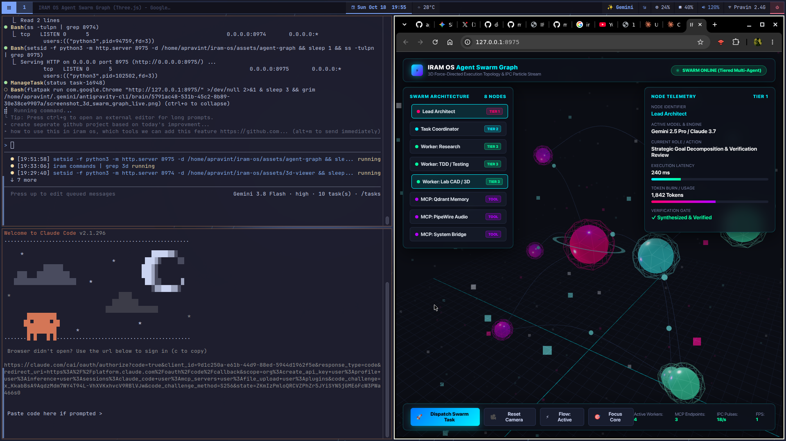
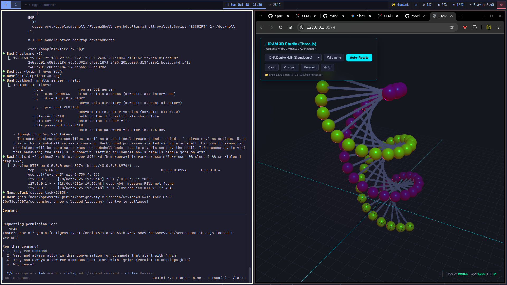
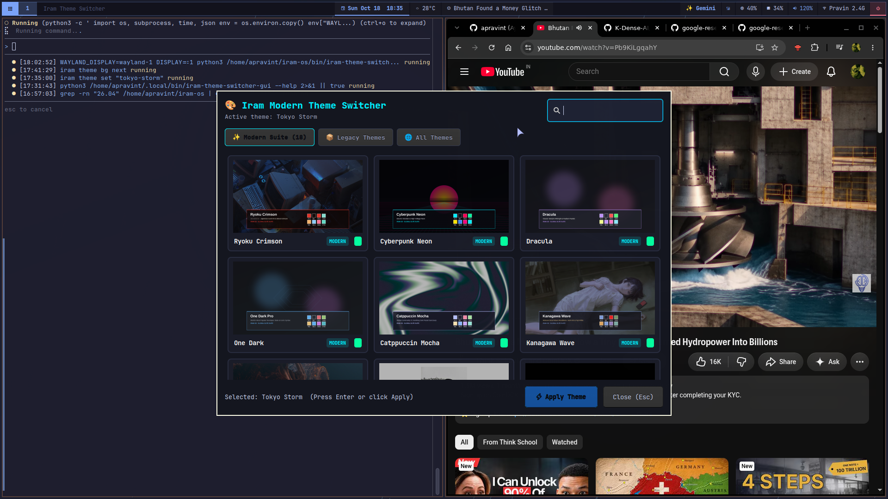
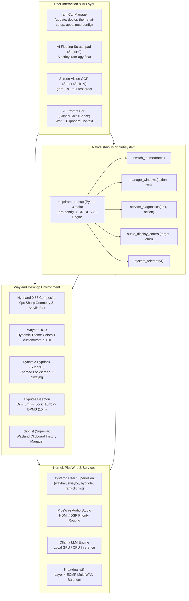

<div align="center">

# IRAM OS 🌌

### The Sovereign Autonomous Agentic Desktop Operating System (v26.04.1)

A high-performance Linux operating system powered by Hyprland, featuring sharp geometric tiling, zero-restart live theme switching across 22+ curated palettes, studio-grade PipeWire audio routing, automated multi-display intelligence, zero-config native stdio Model Context Protocol (MCP) server, and a deeply integrated autonomous AI runtime.

[](https://github.com/apravint/iram-os/releases)
[](https://github.com/apravint/iram-os/releases/tag/v26.04.1)
[](https://releases.ubuntu.com)
[](https://hyprland.org)
[](#-zero-restart-theming-engine-22-palettes)
[](https://modelcontextprotocol.io)
[](https://pipewire.org)
[](https://github.com/apravint/iram-os/actions/workflows/ci.yml)
[](LICENSE)

<br/>

### 📸 Desktop Visual Showcase

<table>
  <tr>
    <td width="50%">
      
      <p align="center"><b>3D Multi-Agent Swarm Topology (Three.js WebGL)</b><br/><code>iram agent graph</code></p>
    </td>
    <td width="50%">
      
      <p align="center"><b>Hardware CAD & Biomolecule Inspector</b><br/><code>iram 3d &lt;model.stl&gt;</code></p>
    </td>
  </tr>
  <tr>
    <td colspan="2">
      
      <p align="center"><b>Zero-Restart Theme Switcher (22+ Curated Palettes & Live Preview Grid)</b><br/><code>iram theme</code> or <code>Super + Alt + T</code></p>
    </td>
  </tr>
</table>

</div>

---

## 🏛️ System Architecture



---

## ⚖️ Why IRAM OS? Comparison Matrix

| Feature | IRAM OS (v26.04.1) | Vanilla Ubuntu 24.04/26.10 | Arch Linux / Hyprland | Omarchy (Upstream) | macOS Sequoia |
| :--- | :---: | :---: | :---: | :---: | :---: |
| **Compositor Engine** | Hyprland 0.56 (Sharp Edges) | GNOME Shell (Mutter) | Manual User Config | Hyprland (Rounded) | Quartz Compositor |
| **Out-of-the-Box Zero Config** | ✅ Turnkey (`install.sh` / ISO) | ✅ Turnkey (GNOME) | ❌ Manual Rice (Days) | ⚠️ Distro-specific | ✅ Turnkey |
| **Native stdio MCP Server** | ✅ `iram-os-mcp` (Zero pip deps) | ❌ None | ❌ None | ❌ None | ❌ None |
| **AI Scratchpad (`Super + \``)** | ✅ Built-in (`iram-agy-float`) | ❌ None | ❌ Manual bind | ❌ None | ❌ None |
| **Screen Vision OCR (`Super + Shift + V`)** | ✅ Built-in (tesseract + AI) | ❌ None | ❌ Manual script | ❌ None | ⚠️ Apple Intelligence |
| **Zero-Restart Theming** | ✅ 22+ Sovereign Palettes | ❌ Requires Log out | ❌ Script hacking | ⚠️ Limited Palettes | ❌ Light / Dark only |
| **Non-Destructive Overrides** | ✅ `user-overrides.conf` | ❌ Overwritten on upgrades | ❌ Manual backups | ❌ Overwrites config | ❌ Locked down |
| **System Diagnostics Doctor** | ✅ `iram doctor` (Table HUD) | ❌ None | ❌ None | ⚠️ Minimal check | ❌ None |
| **Audio Routing Reliability** | ✅ PipeWire + Auto-HDMI/DSP | ⚠️ Standard Pulse/Pipe | ⚠️ Manual pactl | ⚠️ Standard rules | ✅ CoreAudio |
| **RAM Footprint (Idle)** | **~750 MB** | ~1.8 GB | ~600 MB | ~1.2 GB | ~3.5 GB |

---

## 🛠️ The Unified `iram` CLI Management Utility

All system administration, theming, AI configuration, and diagnostics are controlled via the `iram` executable:

```bash
iram <command> [subcommand] [arguments...]
```

### Core Management Subcommands:

| Command | Action & Behavior |
| :--- | :--- |
| `iram update` | Automatically backs up `~/.config/hypr` to a timestamped archive, pulls latest commits from `apravint/iram-os`, runs `install.sh`, reloads the systemd user daemon, restarts `waybar.service` and `swaybg.service`, and executes `hyprctl reload`. |
| `iram doctor` | Verifies Wayland session variables, XDG portals, `hyprctl` responsiveness, systemd user services (`waybar`, `swaybg`, `hypridle`, `iram-cliphist`), PipeWire audio sinks, and `agy`/`ollama`/MCP status, printing an instant PASS/FAIL scorecard table. |
| `iram theme [name]` | Lists all 22 sovereign themes or switches the active theme live with zero compositor restart (`iram theme "Tokyo Storm"`, `iram theme random`, or `iram theme list`). |
| `iram ai-setup` | Auto-detects acceleration hardware (`nvidia-smi` VRAM, `rocm-smi`, or CPU fallback), ensures `ollama` is installed, and pulls the optimal coding model (`qwen2.5-coder:7b` for GPUs $\ge 6\text{GB}$, or `llama3.2:3b` for CPUs/laptops). |
| `iram apps` | Interactive Wofi / terminal installer that clones, sets up, and configures flagship tools (`apravint/video-gen`, `apravint/shorts-creator`, `apravint/BookGeneratorAI`) into `~/Projects/`. |
| `iram mcp-config [--inject]` | Outputs standard MCP configuration JSON or automatically injects the `iram-os-mcp` stdio server entry into `~/.gemini/settings.json`, Antigravity CLI, and Claude configurations. |
| `iram info` | Prints active compositor, Linux kernel, distribution, theme name, and AI agent status HUD. |

---

## 🔌 Native `iram-os-mcp` System Control Server

IRAM OS includes a zero-config, pure Python 3 standard-library Model Context Protocol (MCP) server located at `mcp/iram-os-mcp` (installed to `/usr/local/bin/iram-os-mcp` and `~/.local/bin/iram-os-mcp`). It communicates via standard JSON-RPC 2.0 stdio without requiring external pip packages.

### Exposing 5 Native Tools to AI Coding Agents:

1. **`switch_theme(theme_name)`**: Lists all 22 sovereign palettes or immediately switches Hyprland, Waybar, Wofi, Mako, and Swaybg to the requested palette live.
2. **`manage_windows(action, workspace, window_address)`**: Inspects active windows (`list`), moves windows across workspaces (`movetoworkspace`), toggles floating mode (`togglefloating`), triggers fullscreen (`fullscreen`), focuses windows (`focus`), or closes windows (`close`).
3. **`service_diagnostics(unit_name, action)`**: Reads `systemctl --user status`, inspects `journalctl -u <unit> -n 40` logs, and restarts failed desktop daemons.
4. **`audio_display_control(target, command)`**: Interfaces with PipeWire audio sinks (listing sinks, cycling outputs, toggling mute, adjusting volume) and queries connected display monitors.
5. **`system_telemetry()`**: Returns CPU usage, RAM utilization, GPU VRAM allocation, disk space, and failed systemd units in structured JSON.

---

## ⌨️ Master Keyboard Shortcuts

### 🤖 AI Agent & Productivity Hotkeys
| Shortcut | Action | Description |
| :--- | :--- | :--- |
| `Super + \`` (Grave) | **AI Scratchpad** | Toggle floating Alacritty window running Google Antigravity (`agy`) |
| `Super + Shift + Space` | **AI Prompt Bar** | Prompt via Wofi with automatic Wayland clipboard context injection |
| `Super + Shift + V` | **Screen Vision & OCR** | Snip a screen region with `grim` + `slurp` to copy text or debug errors with AI |
| `Super + V` | **Clipboard History** | Fuzzy search clipboard entries via `cliphist` + `wofi` and copy to clipboard |
| `Super + L` | **Lock Screen** | Lock display immediately using dynamic themed `hyprlock` |
| `Super + Alt + T` / `Super + T` | **Theme Switcher** | Open visual 22-palette theme picker GUI |
| `Super + Shift + W` | **Cycle Wallpaper** | Rotate wallpaper within current theme's curated backgrounds |

### 🪟 Window Navigation & Workspaces
| Shortcut | Action | Description |
| :--- | :--- | :--- |
| `Super + Space` | **Application Launcher** | Open Wofi application launcher |
| `Super + Return` | **Terminal** | Open fast GPU-accelerated Alacritty terminal |
| `Super + Q` / `Super + W` | **Close Window** | Close active focused window |
| `Super + Alt + V` | **Toggle Floating** | Toggle focused window between dynamic tiling and floating mode |
| `Super + F` | **Fullscreen** | Toggle borderless fullscreen |
| `Super + O` | **Pin Window** | Pin floating window across all workspaces (Picture-in-Picture) |
| `Super + S` | **Scratchpad Workspace** | Toggle drop-down special scratchpad workspace |
| `Super + 1` .. `Super + 0` | **Switch Workspace** | Switch to workspaces 1 through 10 |
| `Super + Shift + 1..0` | **Move Window** | Move active window to workspace 1 through 10 |
| `Super + Left/Right/Up/Down` | **Focus Direction** | Move focus between tiled windows |
| `Super + Escape` | **Power Menu** | Power menu (Lock, Suspend, Logout, Reboot, Shutdown) |

---

## 🎨 Zero-Restart Theming Engine (22 Sovereign Palettes)

Switching themes via `iram theme set <name>` or `Super + Alt + T` live-reloads Hyprland border gradients, Waybar styles, Wofi palettes, Mako notifications, and lockscreen colors simultaneously:

```
Tokyo Night          Tokyo Storm          Cyberpunk Neon       Synthwave '84
Catppuccin Mocha     Catppuccin Latte     Everforest           Rose Pine
Rose Pine Moon       Nord Frost           Dracula              Gruvbox
Kanagawa Wave        One Dark             Monokai Pro          Oxocarbon
Aura Dark            Ayu Mirage           Vantablack           Matte Black
Solarized Dark       Flexoki Light
```

---

## 🚀 Installation & Upgrades

### Fresh Installation

```bash
# Clone the repository
git clone https://github.com/apravint/iram-os.git
cd iram-os

# Execute installer
chmod +x install.sh
./install.sh all
```

### Upgrading an Existing System

Upgrades are 100% non-destructive. Custom keybinds and window rules inside `~/.config/hypr/user-overrides.conf` are strictly preserved:

```bash
iram update
```

### System Health Verification

```bash
iram doctor
```

---

## ⚖️ License & Trademarks

This project is licensed under the **[MIT License](LICENSE)**.

- **IRAM OS**: Independent open-source desktop operating system developed and maintained by Ayyappa Pravin.
- **Ubuntu**: Ubuntu is a registered trademark of Canonical Ltd. IRAM OS is an independent project and is not affiliated with, sponsored by, or endorsed by Canonical Ltd.
- **Hyprland, Waybar, PipeWire**: Trademarks belong to their respective creators.
