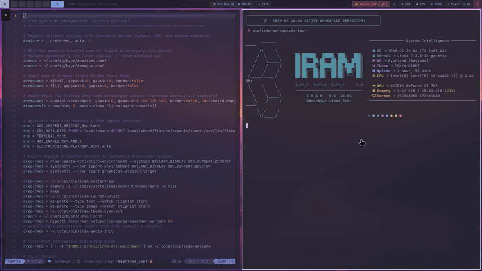
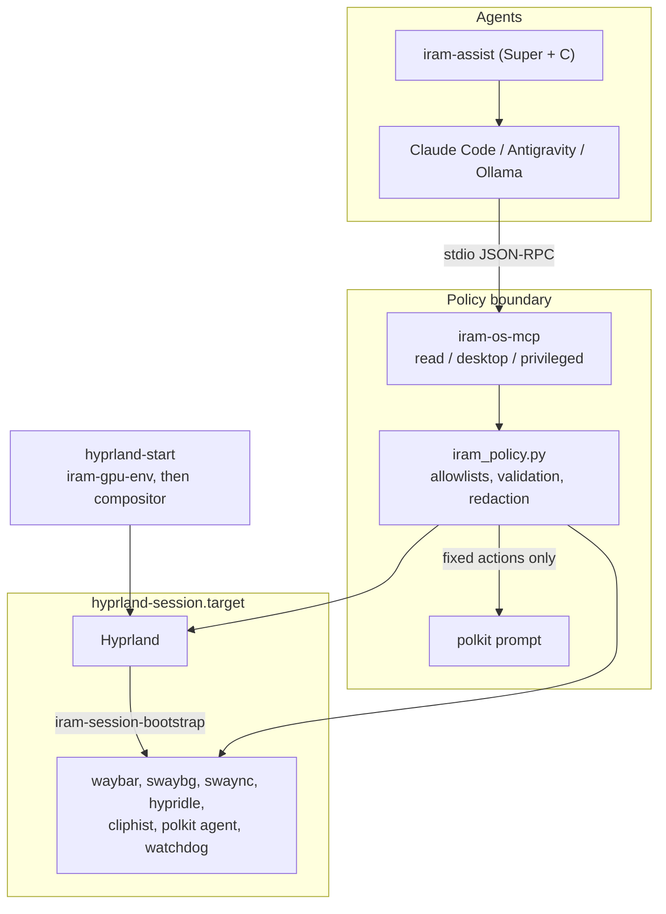

<div align="center">

# IRAM OS

**Hyprland on Ubuntu LTS, set up properly, with an MCP server that lets AI agents operate the desktop inside permission limits you control.**

[](https://github.com/apravint/iram-os/actions/workflows/ci.yml)
[](https://github.com/apravint/iram-os/releases)
[](https://releases.ubuntu.com)
[](LICENSE)



</div>

## Try it

```bash
git clone https://github.com/apravint/iram-os.git && cd iram-os
./install.sh --dry-run   # prints every change and modifies nothing
./install.sh core        # desktop only, no AI stack
```

Then pick **IRAM OS** at your login screen. Before changing anything, the installer backs up your existing configs to `~/.config/iram/backups/`. Profiles are `core`, `ai`, and `all`. There is also a [bootable ISO](#install-from-the-iso).

## What makes it different

**An agent can act on your desktop without getting a shell.** Most "AI OS" projects hand a model a terminal. IRAM's MCP server exposes typed tools in three permission tiers, with arguments validated before anything runs:

| Tier | Examples | Control |
| :--- | :--- | :--- |
| `read` | `hypr_query`, `system_telemetry` (per-GPU VRAM, battery), `crash_report`, `service_diagnostics`, `list_apps`, `screenshot` | No side effects. Credential-shaped strings are masked in logs. `screenshot` is refused while a password manager is on screen, and every capture is logged. |
| `desktop` (default ceiling) | `manage_windows`, `workspace_control`, `window_rule`, `self_heal`, `switch_theme`, `notify`, `launch_app` | Limited to your session and logged to `~/.local/state/iram-os/mcp-audit.jsonl`. No tool can reach Hyprland's `exec`: `launch_app` takes an installed app's desktop ID, never a command, and notifications are always labelled `IRAM agent`. |
| `privileged` (off by default) | `privileged_action`: restart network or Bluetooth, `fstrim`, journal vacuum | Fixed commands only, and each run needs your approval in a polkit prompt. |

```bash
iram mcp-config --inject   # connect Claude Code, Antigravity, and Gemini CLI
```

It has no pip dependencies, only the Python standard library. Raise the ceiling in `~/.config/iram/mcp-policy.json`. The policy lives in [`bin/iram_policy.py`](bin/iram_policy.py), and the tests in [`tests/`](tests/) drive the real server over stdio.

**One shortcut gives the agent your context.** `Super + C` collects the active window, working directory, and clipboard, then opens your agent with them. `Super + Alt + C` adds OCR of a screen region you select. Clipboard text is withheld while a password manager has focus, and secrets are masked. Context reaches the agent through a private temp file, so it never appears in `ps`.

**It keeps working offline.** The launcher tries Claude Code, then Antigravity, then local Ollama, and skips the cloud options when there is no network. `iram ai-setup` picks models that fit your VRAM or RAM.

**The desktop is managed by systemd, not a pile of `exec-once` lines.** Waybar, wallpaper, notifications, clipboard history, idle handling, and the polkit agent are user units under `hyprland-session.target`. They restart on failure and stop cleanly with the session. The session environment reaches systemd and D-Bus before any of them start, and portals are restarted once it is in place, so screen sharing and file pickers get the right environment.

**Hardware settings are detected at every login.** [`iram-gpu-env`](bin/iram-gpu-env) reads `/sys` and sets only what your machine needs:

| Detected | Result |
| :--- | :--- |
| NVIDIA, proprietary driver | `GBM_BACKEND`, `__GLX_VENDOR_LIBRARY_NAME`, `LIBVA_DRIVER_NAME`, software cursor |
| Hybrid Intel or AMD + NVIDIA | `AQ_DRM_DEVICES` with the integrated GPU first, `GBM_BACKEND` left unset |
| AMD or Intel | The right VA-API driver, hardware cursors kept |
| KVM, VirtualBox, VMware | Software cursor, blur off, software GL where the guest has no usable driver |
| NVIDIA card on nouveau | None of the NVIDIA variables |

**Upgrades don't overwrite your edits.** A manifest records what was shipped, so a file you changed stays as it is and the new version lands beside it as `*.iram-new`. Your own settings go in `~/.config/hypr/user-overrides.conf`, which upgrades never touch.

**Config rollback is real.** `iram snapshot restore` extracts into a staging directory, rejects archives with unsafe paths or symlinks, saves your current state first, then swaps directories by rename. Files added since the snapshot are removed rather than merged, and a failed swap rolls back.

**Themes reach apps outside the compositor.** Each of the 55 themes applies live to Hyprland, Waybar, Wofi, Alacritty, btop, cava, hyprlock, and SwayNC. It also sets GTK 3/4, Qt 5/6 (`qt5ct`/`qt6ct`), `gsettings`, and the XWayland cursor, so light and dark mode stay consistent. The one visible flicker is the wallpaper, because `swaybg` has to restart to change image.

## Architecture



## Install from the ISO

Build it with `sudo ./build/build-iso.sh`, or download it from [Releases](https://github.com/apravint/iram-os/releases). The live session is for trying things out and logs in as `iram` with passwordless sudo. To install:

```bash
sudo iram-install-disk   # erases the disk you pick, after you type its path to confirm
```

It creates a GPT layout that boots on UEFI and BIOS, then creates your user. It removes the `iram` account, passwordless sudo, autologin, and casper from the installed system, and generates a fresh machine ID.

## Package install

`build/package-deb.sh` builds `iram-desktop`, `iram-themes`, `iram-ai`, and the `iram-os` metapackage. `build/publish-apt-repo.sh` turns those into a signed APT repository. No public repository is hosted yet, so use `install.sh` or build your own.

## Security notes

- MCP clients should use stdio. The optional FastMCP SSE service has no authentication, so it is off by default.
- The Hub and agent daemon listen on loopback and refuse browser-forged requests, checking `Host`, `Origin`, `Sec-Fetch-Site`, and `Content-Type`. They do not authenticate other local users on a shared machine.
- Agent commands run without a shell, from an allowlist: one program, literal arguments, no chaining.
- `iram-ai-cmd` shows a generated shell command and runs it only if you type `e`. That command is unrestricted, so read it first.
- `install.sh` runs Ollama's upstream install script in the `ai` and `all` profiles. Use `core` to skip it.

## Status

| Tested on every CI run | Not yet covered by automation |
| :--- | :--- |
| 140+ tests: MCP protocol and tiers, policy, snapshot restore, upgrade behavior, GPU profiles, rendering of every theme | Physical hardware matrix (Optimus, suspend, hotplug) |
| `shellcheck`, `systemd-analyze verify`, `.deb` builds | End-to-end `iram-install-disk` run in a VM |
| ISO: root filesystem contents and a QEMU boot to userspace (release builds) | Qt and GTK appearance checks across real apps |

Bug reports with `iram doctor` output are the most useful thing you can send.

## Reference

| Command | Purpose |
| :--- | :--- |
| `iram doctor` | Check session variables, portals, services, audio, and agents |
| `iram snapshot create\|list\|restore` | Config snapshots and rollback |
| `iram theme [name\|list\|random\|auto]` | Switch themes live |
| `iram update [--profile P] [--local]` | Snapshot, pull, reinstall with your install profile, migrate, restart what changed. One run at a time, logged to `~/.local/state/iram/update.log` |
| `iram ai-setup` | Install Ollama and models that fit this machine |
| `iram mcp-config --inject` | Register the MCP server with your agents |

| Shortcut | Action |
| :--- | :--- |
| `Super + C` / `Super + Alt + C` | Context-aware assistant / with region OCR |
| `Super + Alt + A` | Open your agent in a floating terminal |
| `Super + Return` / `Super + Space` | Terminal / launcher |
| `Super + K` | Full keybinding list |
| `Super + Ctrl + Shift + Space` | Theme switcher |
| `Super + L` / `Super + Escape` | Lock / power menu |

Opt-in services, off by default: `iram-organizer.timer` (moves files in `~/Downloads`), `iram-dual-wifi-keepalive.service`, and `iram-mcp-server.service`. Developer notes are in [AGENTS.md](AGENTS.md).

## License

[MIT](LICENSE). IRAM OS is an independent project, not affiliated with or endorsed by Canonical. Ubuntu is a trademark of Canonical Ltd. Hyprland, Waybar, and PipeWire belong to their respective projects.
