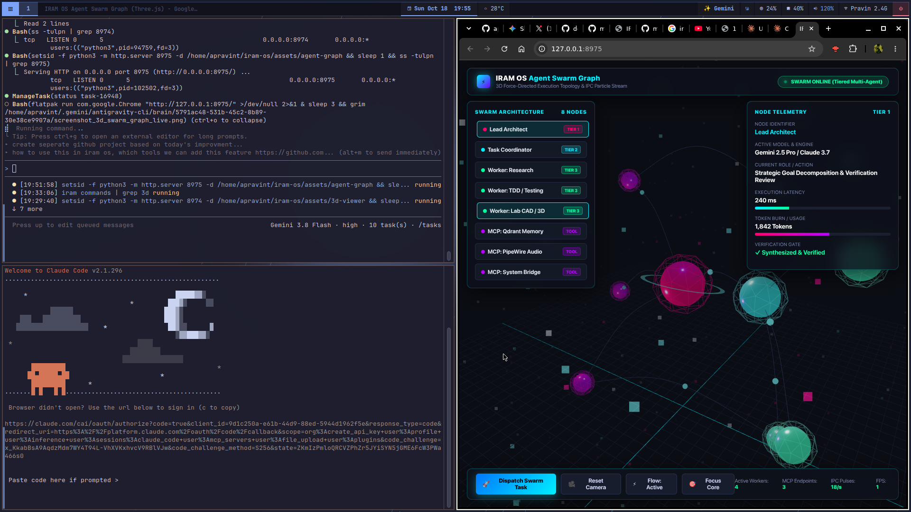
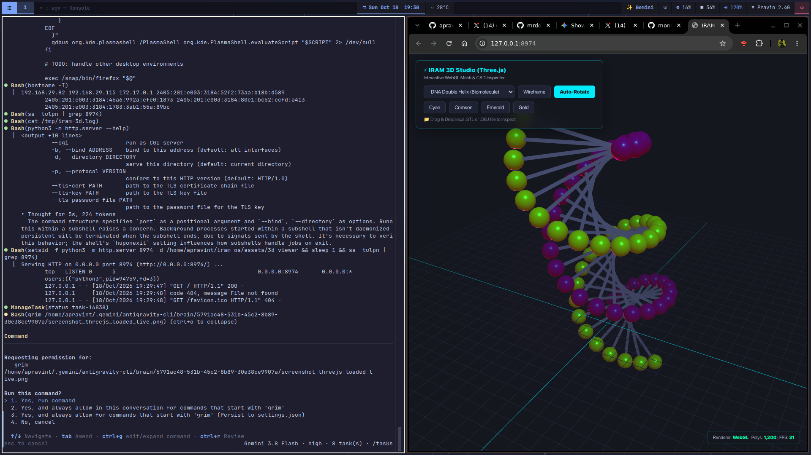
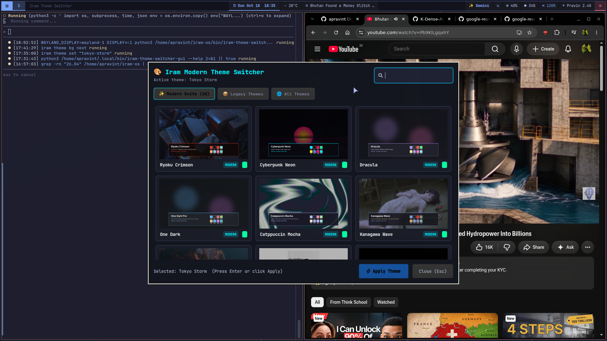

<div align="center">

# IRAM OS 🌌

### The Sovereign Autonomous Agentic Desktop Operating System

A high-performance Linux operating system powered by Hyprland, featuring sharp geometric tiling, zero-restart live theme switching across 43 palettes, studio-grade PipeWire audio routing, automated multi-display intelligence, hardware-isolated agent sandboxing, and a deeply integrated autonomous AI runtime.

[](https://github.com/apravint/iram-os/releases)
[](https://releases.ubuntu.com)
[](https://hyprland.org)
[](#-zero-restart-theming-engine-43-palettes)
[](https://modelcontextprotocol.io)
[](https://pipewire.org)
[](https://github.com/mrdoob/three.js/)
[](https://github.com/apravint/adversarial-pre-push)
[](LICENSE)

<br/>

### 📸 Desktop Visual Showcase

<table>
  <tr>
    <td width="50%">
      
      <p align="center"><b>3D Multi-Agent Swarm Topology (Three.js WebGL)</b><br/><code>iram agent graph</code></p>
    </td>
    <td width="50%">
      
      <p align="center"><b>Hardware CAD & Biomolecule Inspector</b><br/><code>iram 3d &lt;model.stl&gt;</code></p>
    </td>
  </tr>
  <tr>
    <td colspan="2">
      
      <p align="center"><b>Zero-Restart Theme Switcher (43 Curated Palettes & Live Preview Grid)</b><br/><code>iram theme</code> or <code>Super + T</code></p>
    </td>
  </tr>
</table>

</div>

---

## 📖 About IRAM OS

### What is IRAM OS?
**IRAM OS** is an independent, turnkey 64-bit Linux operating system distribution engineered from the ground up for modern developers, power users, and autonomous AI engineering. It bridges the gap between ultra-fluid Wayland dynamic tiling and sovereign desktop computing, providing a cohesive environment where the user interface, system hardware, and local/cloud AI agents collaborate seamlessly.

### The Vision: The Operating System as an Agentic Substrate
Traditional operating systems treat artificial intelligence as a passive side-panel chatbot. IRAM OS fundamentally rethinks the desktop by making the system itself agent-controllable and self-healing:
- **Agents can observe and query**: Window hierarchy, active workspaces, PipeWire audio routing topology, system telemetry, and clipboard history via standard Model Context Protocol (MCP).
- **Agents can act**: Dispatch windows, switch themes, execute sandboxed code-as-action snippets in rootless bubblewrap jails, and diagnose failed services without human friction.
- **Zero Configuration Headaches**: Multi-monitor offsets, audio sink stalls, and manual daemon configuration are solved out of the box with intelligent automation.

### Project Heritage & Evolution
IRAM OS was originally inspired by the desktop concept of **Omarchy** authored by David Heinemeier Hansson (DHH). Recognizing the demand for a turnkey, production-grade operating system with native dual-monitor resilience, systemd service supervision, and a full-stack autonomous AI runtime, the project was completely re-architected into an independent distribution:
1. **Desktop Engine**: Engineered sharp 90° geometry (`rounding = 0`), acrylic background blur, flush edge-to-edge status bar, and custom dual-display collision avoidance (`iram-displays-gui`).
2. **Audio Stack**: Built studio-grade PipeWire/WirePlumber priority rules with instant 1-key output cycling across analog lines, HDMI converters, and Bluetooth.
3. **Agentic Layer**: Integrated embedded vector memory (Qdrant), temporal knowledge graphs (Graphiti), BM25 context compression (`context-condenser`), episodic hindsight memory (`agent-hindsight`), and rootless code isolation (`agent-jail`).
4. **Sovereign Awareness**: Native radar feeds monitoring global live CCTV streams, AIS maritime vessels, ADS-B aircraft telemetry, and seismic events (`iram worldmonitor`).
5. **Distribution Pipeline**: Built a hybrid UEFI/BIOS bootable Live ISO compiler that produces flashable, autologin media with bare-metal installer capability.

---

## 🏛️ System Architecture

```mermaid
graph TD
    subgraph L1["Sovereign Agentic Runtime"]
        Hub["Sovereign Hub (Super+H)<br/>Multi-Turn Chat & Quick Chips"]
        MCP["FastMCP 2.0 Desktop Server<br/>Window / Audio / Workspace Stdio"]
        Jail["Agent-Jail Sandbox<br/>Rootless Bubblewrap AST Engine"]
        Mem["Context & Memory Layer<br/>BM25 Condenser + Hindsight FTS5"]
        Swarm["Three.js Swarm Graph<br/>3D Multi-Agent Visualizer"]
    end

    subgraph L2["Wayland Desktop Environment"]
        Hypr["Hyprland 0.56 (0px Sharp Geometry)<br/>Acrylic Blur & Multi-Monitor Affinities"]
        Bar["Waybar HUD<br/>Flush Telemetry, MCP Pill & Audio Sink"]
        Themes["43 Zero-Restart Theme Engine<br/>Live CSS & Compositor Sync"]
        Layout["Hybrid Desktop Switcher<br/>Tiling vs Traditional Floating"]
    end

    subgraph L3["Spatial, Audio & Situation Awareness"]
        Voice["VoiceStudio Engine<br/>Neural Zero-Shot Voice Cloning"]
        WebGL["Three.js 3D Mesh Studio<br/>CAD, STL, OBJ & Biomolecules"]
        Radar["Sovereign WorldMonitor<br/>CCTV, AIS Maritime, ADS-B Flights"]
        Pipe["PipeWire Studio Router<br/>Sidechain Ducking & HDMI Priority"]
    end

    subgraph L4["Kernel, Security & Hardware Layer"]
        OS["Debian / Ubuntu 26.10 Core<br/>systemd User Supervision"]
        Net["linux-dual-wifi<br/>Layer 4 ECMP Multi-WAN Balancer"]
        Sec["adversarial-pre-push<br/>6-Phase Git Audit Gatekeeper"]
    end

    L1 --> L2
    L2 --> L3
    L3 --> L4
```



---

## 🌟 Key Highlights & Innovations

### 1. 🤖 Sovereign Command Hub & AI Desktop (`Super + H`)
- **Interactive Multi-Turn Drawer**: Slide-out floating AI command center (`Super + H` or `iram hub`) with continuous conversational context.
- **Local-First Model Routing**: Integrates local Ollama inference with cloud fallbacks via intelligent circuit breakers and token-saving BM25 response caching.
- **Multimodal Screen Vision (`Super + Shift + Print`)**: Snip any region of your screen to extract text, analyze UI errors, or trigger instant AI code generation with action chips.
- **Desktop Stdio FastMCP**: Built-in `iram-mcp-server` exposing Hyprland window tiling, audio routing, display geometry, theme changes, and systemd services to Claude, Cursor, and Antigravity.

### 2. 🎨 Zero-Restart Theming Engine (43 Curated Palettes)
Switching themes via `Super + T` or `iram theme` dynamically re-skins Hyprland borders, Waybar styling, Wofi palettes, terminal colors, and desktop notifications simultaneously with **zero session restarts**.

| Category | Palettes Included |
| :--- | :--- |
| **Cyber & Synth** | Cyberpunk Neon, Synthwave '84, Oxocarbon, Aura Dark, Ryoku Crimson |
| **Tokyo & Japanese** | Tokyo Night, Tokyo Storm, Kanagawa Wave, Kanagawa Dragon |
| **Classic Developer** | Catppuccin Mocha, One Dark, Monokai Pro, Dracula, Nord Frost, Solarized Dark |
| **Organic & Earth** | Everforest, Rose Pine Moon, Ayu Mirage, Vesper, Ristretto, Solitude |
| **Minimalist & Monolith** | Vantablack, White Monochrome, Retro '82, Material Ocean, Gruvbox |

*Preview materials and lighting dynamically in the **Three.js 3D Theme Studio** using `iram theme 3d`.*

### 3. 🛡️ Hardened Security & Rootless Agent Sandboxing
- **`agent-jail`**: Autonomous code agents execute inside unprivileged, rootless Bubblewrap containers with isolated filesystem mounts, loopback-only networking, and strict process limits.
- **`adversarial-pre-push`**: Integrated 6-phase pre-push git security gate with Hunter/Verifier separation that blocks credential leaks, hardcoded paths, and suspicious `eval/exec` payloads before code leaves your machine.
- **`iram-toolgate`**: Enforces a 7-point risk evaluation firewall before any agent can execute destructive bash or filesystem operations.

### 4. 🧠 High-Efficiency Context & Long-Term Memory
- **`context-condenser`**: Compresses terminal logs, git diffs, and large source files by up to **98%** using lexical BM25 ranking—zero LLM token costs, zero latency.
- **`agent-hindsight`**: Persistent episodic memory engine with exponential recency decay and SQLite FTS5 full-text indexing, eliminating the need for heavy vector DB Docker containers.
- **Embedded Qdrant & Graphiti**: High-speed local dense vector retrieval and temporal knowledge graphs tracking project decisions across sessions.

### 5. 📡 Multi-WAN Dual Wi-Fi Load Balancer (`linux-dual-wifi`)
- Bonds multiple physical wireless adapters (e.g. onboard Wi-Fi + external high-gain USB dongle) simultaneously.
- Distributes outbound TCP/UDP connections using Linux kernel Layer 4 ECMP flow hashing.
- Automated systemd keepalive service that gracefully sleeps when adapters are detached, preventing crash loops.

### 6. 🌐 Sovereign WorldMonitor Radar (`Super + Alt + I`)
- Real-time global situational awareness hub launched via hotkey or Wofi root menu.
- **Live CCTV Surveillance Feeds**: Real-time HLS streams from Tokyo Shibuya Crossing, New York Times Square, ISS Low Earth Orbit, London Piccadilly, and Chennai Harbour.
- **AIS Maritime & ADS-B Aviation**: Live ship positioning radar and flight transponder tracking.
- **Global Seismic Monitor**: Live earthquake and volcanic activity telemetry.

### 7. 🎛️ Hybrid Traditional vs Tiling Layout Switcher
- New to dynamic tiling? Toggle instantly between **Strict Tiling Mode** and **Traditional Floating Desktop** with taskbars using `Super + Alt + L` or `iram layout`.
- Ships with an interactive **Welcome Onboarding GUI** (`iram welcome`) to customize themes, monitors, and audio devices on first launch.

---

## 🤖 The Autonomous Agentic Toolchain

IRAM OS embeds an exhaustive suite of autonomous engineering binaries in `bin/` and `~/.local/bin/`:

| Subsystem | Command | Description |
| :--- | :--- | :--- |
| **Sovereign Hub** | `iram hub` (`Super + H`) | Slide-out interactive agent chat drawer with local Ollama routing and action chips |
| **Agent Dispatcher** | `iram agent` (`Super + A`) | Hierarchical agent tree (Architect reasoning $\rightarrow$ Coordinator $\rightarrow$ Worker fleet) |
| **Agent Sidecar** | `iram-agent-sidecar` | Floating companion window providing persistent desktop assistance |
| **Model Context Protocol** | `iram-mcp-server` | FastMCP 2.0 server bridging Hyprland, audio, and system actions to LLMs |
| **Rootless Code Sandbox**| `iram-code-agent` | AST Python executor powered by smolagents inside Bubblewrap containment |
| **Context Compressor** | `iram-context-condenser` | 98% BM25 context compression engine for coding agent sessions |
| **Episodic Memory** | `iram-memory` | Temporal memory with recency decay (`agent-hindsight`) and Qdrant vector store |
| **Adversarial Gate** | `iram-pre-push` | 6-phase pre-push git security audit engine with Hunter/Verifier separation |
| **Screen Vision** | `iram vision` (`Super+Shift+Print`) | Multimodal desktop snapshot analyzer with interactive OCR action chips |
| **VoiceStudio** | `iram voice` (`Super+Alt+V`) | Sovereign zero-shot voice cloning, prompt-to-voice design, and multilingual dubbing |
| **3D CAD Mesh Studio** | `iram 3d <file.stl>` | Three.js WebGL hardware inspector for 3D CAD meshes and biomolecules |
| **3D Swarm Visualizer** | `iram agent graph` | Force-directed 3D multi-agent swarm graph with animated IPC photon conduits |
| **Situation Radar** | `iram worldmonitor` (`Super+Alt+I`) | Global situation awareness radar (CCTV, AIS Maritime, ADS-B Flights, Quakes) |
| **Audio Tuning** | `iram-audio-tuning` | Studio DSP equalization and pipewire output routing rules |
| **Dual Wi-Fi Balancer** | `iram-dual-wifi` | Multi-WAN Layer 4 ECMP network bonding daemon |
| **Layout Switcher** | `iram-layout-switch` | Instant toggle between strict Hyprland tiling and traditional floating desktop |
| **Self-Healing Agent** | `iram-health-agent` (`Super+Ctrl+H`) | Autonomous diagnosis and recovery for failed systemd services and audio sinks |

---

## ⌨️ Master Keyboard Shortcuts Cheat Sheet

### 🤖 Autonomous AI & Sovereign Tools
| Shortcut | Action | Description |
| :--- | :--- | :--- |
| `Super + H` | **Sovereign Hub** | Slide-out interactive agent chat drawer and command bar |
| `Super + A` | **Agent Tree** | Launch autonomous hierarchical agent fleet |
| `Super + Shift + A` | **AI Sidecar** | Open floating persistent AI companion window |
| `Super + Ctrl + H` | **Health Agent** | Trigger AI self-healing diagnostic recovery for services |
| `Super + Alt + V` | **VoiceStudio** | Launch voice cloning and speech synthesis studio |
| `Super + Shift + Print` | **Screen Vision** | Capture screen region for multimodal vision analysis |
| `Super + Shift + O` | **OCR Action Chips** | Extract on-screen text with copy/search/AI action chips |
| `Super + Alt + I` | **Sovereign Radar** | Open WorldMonitor radar (CCTV, Flights, Vessels) |
| `Super + Alt + S` | **Security Audit** | Execute adversarial security audit on current project |
| `Super + Alt + F` | **Financial Intel** | Open DCF valuation and algorithmic financial terminal |
| `Super + Alt + A` | **Architecture** | Open interactive SVG software architecture visualizer |
| `Super + Alt + O` | **Swarm Team** | Launch multi-agent swarm collaboration session |

### 🪟 Window Management & Workspaces
| Shortcut | Action | Description |
| :--- | :--- | :--- |
| `Super + Return` | **Terminal** | Launch GPU-accelerated Alacritty terminal |
| `Super + Alt + Return` | **Tmux Session** | Open Alacritty attached to persistent tmux workspace |
| `Super + Q` / `Super + W` | **Close Window** | Close active focused window |
| `Super + V` | **Toggle Floating** | Switch focused window between tiling and floating mode |
| `Super + F` | **Fullscreen** | Toggle borderless fullscreen |
| `Super + O` | **Pin / PiP** | Pin floating window across all workspaces (Picture-in-Picture) |
| `Super + G` | **Tabbed Group** | Group active windows into a tabbed container |
| `Super + S` or `Super + \`` | **Scratchpad** | Toggle dropdown quick scratchpad workspace |
| `Super + 1` .. `Super + 0` | **Switch Workspace** | Navigate to workspaces 1 through 10 |
| `Super + Shift + 1..0` | **Move Window** | Move focused window to specific workspace |
| `Super + Left/Right/Up/Down`| **Focus Move** | Move focus between tiled windows |

### 🎨 Themes, Audio & Displays
| Shortcut | Action | Description |
| :--- | :--- | :--- |
| `Super + T` | **Theme Switcher** | Open visual selector for all 43 Curated Themes |
| `Super + Shift + W` | **Next Wallpaper** | Cycle high-resolution wallpaper within active theme |
| `Super + Shift + A` | **Cycle Audio Output** | Instantly route audio between 3.5mm, HDMI, and Bluetooth |
| `Super + Ctrl + D` | **Display Manager** | Open `iram-displays-gui` monitor alignment panel |
| `Super + Ctrl + L` | **Lock Screen** | Lock session via native `hyprlock` |
| `Super + Escape` | **Power Menu** | Quick power menu (Lock, Suspend, Reboot, Shutdown) |
| `Super + Shift + Space` | **Toggle Bar** | Toggle Waybar visibility |
| `Super + Ctrl + Shift + B` | **Restart Bar** | Reload Waybar and recompile CSS stylesheets |

---

## 🚀 Installation & Deployment

### Method 1: Automated Script (Recommended)

Run the automated installer on an existing Ubuntu/Debian/Arch Linux environment:

```bash
# Clone repository
git clone https://github.com/apravint/iram-os.git
cd iram-os

# Launch installer
chmod +x install.sh
./install.sh
```

Or deploy directly via curl:

```bash
curl -fsSL https://raw.githubusercontent.com/apravint/iram-os/main/install.sh | bash
```

#### Launching the Desktop:
1. Log out of your current display manager.
2. At the login screen (GDM, SDDM, or LightDM), select session **IRAM OS** (or **Hyprland**).
3. Log in to launch the sovereign desktop.

---

### Method 2: Bootable Live ISO (Bare-Metal & USB)

A hybrid UEFI/BIOS bootable Live ISO is compiled and released for direct hardware testing:

1. Download the latest ISO from [GitHub Releases](https://github.com/apravint/iram-os/releases).
2. Flash to a USB drive using [Ventoy](https://www.ventoy.net/), [BalenaEtcher](https://etcher.balena.io/), or standard `dd`:
   ```bash
   sudo dd if=iram-os-26.10-amd64.iso of=/dev/sdX bs=4M status=progress oflag=sync
   ```
3. Boot the machine from USB and choose **Start IRAM OS Live**:
   - **Default User**: `iram`
   - **Password**: `iram` *(Passwordless sudo enabled)*

---

## 🌐 The Modular Open-Source Ecosystem

IRAM OS is architected into standalone, independently maintainable open-source packages:

| Repository | Focus & Role |
| :--- | :--- |
| [**`hypr-doctor`**](https://github.com/apravint/hypr-doctor) | Static analysis linter, duplicate keybinding detector & autostart auditor for Hyprland |
| [**`hypr-agentic-config`**](https://github.com/apravint/hypr-agentic-config) | Turnkey, conflict-free Hyprland 0.56 + Waybar dotfiles & systemd autostart suite |
| [**`context-condenser`**](https://github.com/apravint/context-condenser) | 98% BM25 Context Compression Engine for AI Coding Agents (Claude, Cursor, Antigravity) |
| [**`agent-hindsight`**](https://github.com/apravint/agent-hindsight) | Temporal long-term episodic memory engine with recency decay and SQLite FTS5 |
| [**`adversarial-pre-push`**](https://github.com/apravint/adversarial-pre-push) | 6-phase adversarial vulnerability auditing git pre-push gate with Hunter/Verifier separation |
| [**`linux-dual-wifi`**](https://github.com/apravint/linux-dual-wifi) | Multi-WAN & Dual Wi-Fi ECMP load balancer with Layer 4 flow hashing daemon |
| [**`fastmcp-linux-desktop`**](https://github.com/apravint/fastmcp-linux-desktop) | FastMCP 2.0+ Model Context Protocol server for Linux desktops (Hyprland, PipeWire, systemd) |
| [**`archify-py`**](https://github.com/apravint/archify-py) | Zero-dependency interactive SVG and HTML architecture visualizer for software projects |
| [**`iram-themes`**](https://github.com/apravint/iram-themes) | 43 modern Wayland themes and dynamic multi-application palette synchronization engine |
| [**`iram-agentic-desktop`**](https://github.com/apravint/iram-agentic-desktop) | Autonomous AI Desktop Framework: terminal copilot, sidecar companion, and model router |
| [**`storytold-craft-linux`**](https://github.com/apravint/storytold-craft-linux) | Native packaging and AppImage runners for the Storytold pure-Rust creative desktop suite |
| [**`ubuntu-hyprland-iso-builder`**](https://github.com/apravint/ubuntu-hyprland-iso-builder) | Automated toolchain & GitHub Actions CI compiling bootable Ubuntu 26.10 + Hyprland ISOs |
| [**`way-ocr`**](https://github.com/apravint/way-ocr) | Lightweight screen OCR and interactive text action chip extractor for Wayland |

---

## 🏗️ Compiling the ISO from Source

To build a fresh bootable ISO using the Ubuntu 26.10 toolchain:

```bash
git clone https://github.com/apravint/iram-os.git
cd iram-os

# Run the ISO compiler (requires sudo)
sudo bash build/build-iso.sh
```

The compiled bootable ISO and SHA-256 integrity checksum will be generated in `out/`.

---

## ⚖️ License & Trademarks

This project is licensed under the **[MIT License](LICENSE)**.

### Legal Notices
- **IRAM OS**: Independent open-source desktop operating system developed and maintained by Ayyappa Pravin.
- **Ubuntu**: Ubuntu is a registered trademark of Canonical Ltd. IRAM OS is an independent project and is not affiliated with, sponsored by, or endorsed by Canonical Ltd.
- **Third-Party Trademarks**: Hyprland, Waybar, PipeWire, Three.js, Qdrant, and all other referenced trademarks belong to their respective creators.

---

## ❤️ Acknowledgments & Credits

- **Canonical & The Ubuntu Community**: For the foundational Debian/Ubuntu package ecosystem and hardware driver compatibility.
- **David Heinemeier Hansson (DHH)** & the **Omarchy Community**: For the initial desktop concept and aesthetic inspiration.
- **Vaxry and the Hyprland Team**: For creating the most fluid Wayland dynamic tiling compositor.
- **The PipeWire & WirePlumber Engineers**: For glitch-free, professional-grade Linux audio routing.
- **The Model Context Protocol (FastMCP) Team**: For standardizing the interface between AI agents and desktop environments.
- **All Community Contributors & Testers**: To every stargazer, tester, and developer helping build the sovereign agentic future.

</div>
