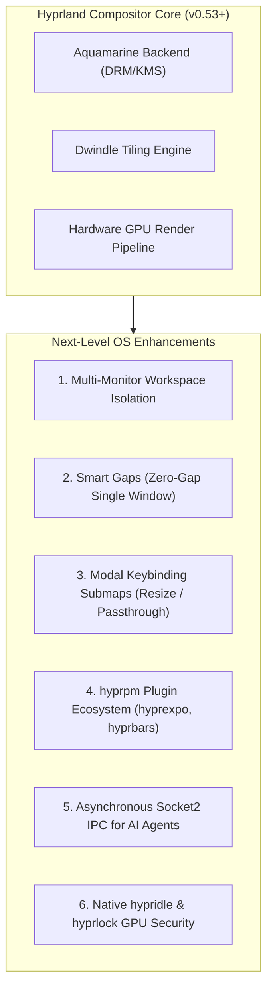

# 🪟 Comprehensive Guide: Elevating Hyprland in IRAM OS (2026)

Strategies, architectural upgrades, and configuration blueprints to transform **Hyprland v0.53+** into an elite, responsive, agent-aware Wayland desktop.

---

## 🏛️ Hyprland Modern Architecture Overview



---

## ⚡ 1. Dedicated Multi-Monitor Workspace Binding

In dual-monitor setups (e.g. Samsung primary + Sony secondary), vanilla Hyprland allows workspaces to float between monitors. Binding workspaces explicitly eliminates cross-screen jumping:

```ini
# Add to ~/.config/hypr/hyprland.conf
# Primary Monitor (Samsung) dedicated Workspaces 1-5
workspace = 1, monitor:desc:Samsung Electric Company SAMSUNG 0x01000E00, default:true
workspace = 2, monitor:desc:Samsung Electric Company SAMSUNG 0x01000E00
workspace = 3, monitor:desc:Samsung Electric Company SAMSUNG 0x01000E00
workspace = 4, monitor:desc:Samsung Electric Company SAMSUNG 0x01000E00
workspace = 5, monitor:desc:Samsung Electric Company SAMSUNG 0x01000E00

# Extended Display (Sony TV) dedicated Workspaces 6-10
workspace = 6, monitor:desc:Sony SONY TV  *00 0x01010101, default:true
workspace = 7, monitor:desc:Sony SONY TV  *00 0x01010101
workspace = 8, monitor:desc:Sony SONY TV  *00 0x01010101
workspace = 9, monitor:desc:Sony SONY TV  *00 0x01010101
workspace = 10, monitor:desc:Sony SONY TV  *00 0x01010101
```

---

## 📐 2. Smart Gaps (Zero-Gap Maximized Focus)

When you only have a single window open on a workspace, outer margins waste screen real estate. Enable dynamic smart gaps so single windows go edge-to-edge automatically, while multiple windows get clean 2px/4px borders:

```ini
# Smart Gaps & Borders (Hyprland v0.42+)
workspace = w[tv1], gapsout:0, gapsin:0
workspace = f[1], gapsout:0, gapsin:0
windowrulev2 = bordersize 0, floating:0, onworkspace:w[tv1]
windowrulev2 = rounding 0, floating:0, onworkspace:w[tv1]
```

---

## 🎹 3. Modal Keybinding Submaps (Vim-Style Navigation)

Eliminate keybinding conflicts by grouping complex operations into submaps:

### A. Window Resize Submap
```ini
bind = Super, R, submap, resize

submap = resize
binde = , right, resizeactive, 20 0
binde = , left, resizeactive, -20 0
binde = , up, resizeactive, 0 -20
binde = , down, resizeactive, 0 20
binde = , l, resizeactive, 20 0
binde = , h, resizeactive, -20 0
binde = , k, resizeactive, 0 -20
binde = , j, resizeactive, 0 20
bind = , escape, submap, reset
bind = , Return, submap, reset
submap = reset
```

### B. Passthrough Submap (For Virtual Machines / Remote Desktop)
```ini
bind = Super, P, submap, passthrough
submap = passthrough
bind = Super, Escape, submap, reset
submap = reset
```

---

## 🧩 4. Hyprland Plugin Manager (`hyprpm`)

Hyprland ships with an official plugin manager `hyprpm`.

### Enable Official Hyprland Plugins:
```bash
hyprpm update
hyprpm add https://github.com/hyprwm/hyprland-plugins
hyprpm enable hyprexpo
hyprpm enable hyprbars
```

* **`hyprexpo`**: Press `Super + Tab` for a macOS Mission Control-style 3x3 visual overview of all workspaces.
* **`hyprbars`**: Adds sleek titlebars with min/max/close buttons to floating windows and dialogs.

---

## 🤖 5. Agentic AI Integration via UNIX `socket2.sock`

Hyprland exposes a real-time event streaming socket at:
`$XDG_RUNTIME_DIR/hypr/$HYPRLAND_INSTANCE_SIGNATURE/.socket2.sock`

Instead of polling `hyprctl` every second, IRAM OS agent services (`iram-agent`, `iram-vision`, `iram-monologue`) can subscribe to compositor events:

```python
import socket
import os

sock_path = f"{os.getenv('XDG_RUNTIME_DIR')}/hypr/{os.getenv('HYPRLAND_INSTANCE_SIGNATURE')}/.socket2.sock"

with socket.socket(socket.AF_UNIX, socket.SOCK_STREAM) as s:
    s.connect(sock_path)
    while True:
        event = s.recv(1024).decode('utf-8')
        # Events: workspace>>2, openwindow>>..., activewindow>>...
        print(f"[Agent Perception] Compositor event: {event.strip()}")
```

This enables the AI agent to:
- Auto-detect when an IDE or terminal errors out.
- Auto-tag screen recordings when specific applications are active.
- Organize windows autonomously based on user intent.

---

## 🔒 6. GPU-Accelerated Lock & Idle (`hypridle` & `hyprlock`)

Replace legacy lockscreens with modern GPU shaders:
* **`hyprlock`**: Native Wayland screen locker rendering real-time blurred snapshots of the current desktop with zero authentication flicker.
* **`hypridle`**: Turns off display backlights on battery/idle and dims screens smoothly using DPMS.
