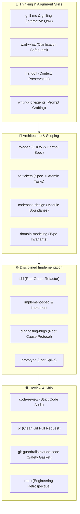

# Matt Pocock's "Skills for Real Engineers" (2026)

A curated catalog of the battle-tested agent skills authored by [Matt Pocock](https://github.com/mattpocock/skills) (Total TypeScript). 

> **Core Philosophy**:
> *"Skills for Real Engineers — not vibe coding. Developing real applications is hard. Heavy frameworks try to own the entire process, taking away your control and making bugs hard to resolve. These skills are small, composable, and designed to keep you in control while maximizing agent rigor."*

---

## 🛠️ The Skills Taxonomy

---

## 📋 Comprehensive Skills Directory

### 1. Engineering Skills (`skills/engineering/`)
| Skill | Role & Focus |
| :--- | :--- |
| **`ask-matt`** | Deep technical advice on TypeScript, API ergonomics, and typing patterns. |
| **`code-review`** | Rigorous code review auditing maintainability, edge cases, and typing correctness. |
| **`codebase-design`** | Architectural boundaries, dependency graphs, and separation of concerns. |
| **`diagnosing-bugs`** | Hypothesis-driven root cause analysis avoiding hasty trial-and-error edits. |
| **`domain-modeling`** | Type-driven domain models encoding business rules into the compiler. |
| **`grill-with-docs`** | Architectural alignment interrogations referencing official documentation. |
| **`implement-spec`** | Executes approved technical specifications without deviating from plan. |
| **`implement`** | Focused, atomic implementation cycles with continuous test checks. |
| **`improve-codebase-architecture`** | Incremental refactoring patterns for monolithic or legacy debt. |
| **`pr`** | Formats concise, human-reviewable pull requests with changelogs and context. |
| **`prototype`** | Fast technical spikes to de-risk design decisions with minimal overhead. |
| **`research`** | Targeted codebase exploration to understand existing patterns before coding. |
| **`retro`** | Engineering retrospective to isolate failure modes and persist lessons. |
| **`tdd`** | Strict Test-Driven Development discipline (write failing test ➔ write minimal code ➔ refactor). |
| **`to-spec`** | Distills rambling feature brainstorms into structured engineering specifications. |
| **`to-tickets`** | Deconstructs specifications into granular, sequenced implementation tickets. |
| **`triage`** | Evaluates incoming bug reports for reproduction steps, priority, and validity. |
| **`wayfinder`** | Fast codebase navigation mapping where features and configurations live. |
| **`wizard`** | Interactive multi-step setup guides for complex frameworks and libraries. |

### 2. Productivity & Alignment Skills (`skills/productivity/`)
| Skill | Role & Focus |
| :--- | :--- |
| **`grill-me`** | Interrogates the user with probing design questions to eliminate ambiguous assumptions before coding. |
| **`grilling`** | Deep Socratic questioning protocol to pressure-test architectural ideas. |
| **`handoff`** | Serializes active mental models, task progress, and open issues for session handoffs. |
| **`teach`** | Explains complex computer science or language concepts with clear mental models. |
| **`to-questionnaire`** | Converts complex architectural trade-offs into simple multiple-choice surveys. |
| **`wait-what`** | Circuit breaker triggering when an agent detects contradictory or impossible requirements. |
| **`writing-for-agents`** | Guidelines for writing prompts and task definitions that prevent agent hallucinations. |

### 3. Safety & Workflow Skills (`skills/misc/` & `skills/in-progress/`)
| Skill | Role & Focus |
| :--- | :--- |
| **`git-guardrails-claude-code`** | Safety gasket preventing destructive git commands (`git reset --hard`, accidental force pushes). |
| **`setup-pre-commit`** | Scaffolds automated linters, type checks, and formatters before commit creation. |
| **`chief-of-staff`** | Macro coordinator organizing sub-agents and high-level project goals. |
| **`loop-me`** | Autonomous rapid feedback loops for recurring tasks and automated validation. |
