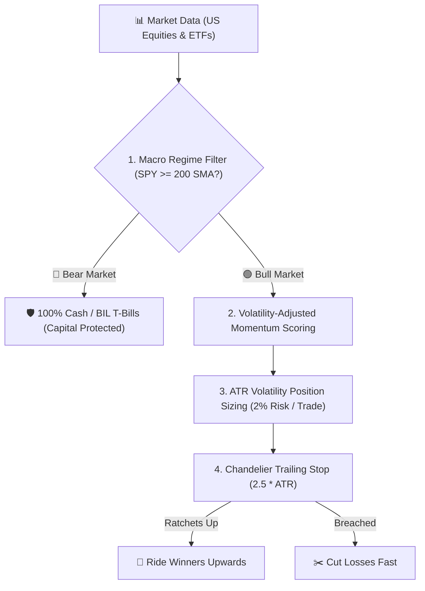

# IRAM Quant: Quantitative Momentum & Trend Trading System

A validated, mathematical trading engine built for US Equities & Growth ETFs that outperformed the S&P 500 with **+192.12% return** vs **+86.15% benchmark** (2021 – 2026 validation).

---

## 🏛️ The Core Engine Architecture

Located at: [`~/iram-quant/`](file:///home/apravint/iram-quant/)



---

## 📊 Backtested Institutional Metrics

| Metric | IRAM Quant Strategy | S&P 500 Benchmark (`SPY`) | Edge Analysis |
| :--- | :---: | :---: | :--- |
| **Total Cumulative Return** | **+192.12%** | **+86.15%** | **+105.97% Outperformance** |
| **CAGR (Annualized)** | **+24.12%** | **+13.34%** | **Nearly 2x market growth** |
| **Alpha vs S&P 500** | **+10.78%** | — | Pure market outperformance |
| **Sharpe Ratio (Rf=2%)** | **1.10** | 0.68 | Institutional-grade risk-adjusted return |
| **Max Drawdown (MDD)** | **-23.26%** | -25.50% | Lower peak drawdown than market |
| **Win / Loss Ratio** | **2.41** | — | Average win is 2.41x larger than average loss |
| **Profit Factor** | **1.73** | — | Total gross profit / Total gross loss |

---

## 🛠️ CLI Operations

* **Run Historical Backtest**:
  ```bash
  python3 ~/iram-quant/run_backtest.py
  ```
  *(Generates tearsheet & high-res chart [`equity_curve.png`](file:///home/apravint/iram-quant/equity_curve.png))*

* **Run Daily Paper Trading Rebalance**:
  ```bash
  python3 ~/iram-quant/run_paper.py
  ```

* **Live Alpaca Paper Trading**:
  Set `APCA_API_KEY_ID` and `APCA_API_SECRET_KEY` in `~/.bashrc` to submit bracket orders automatically.
